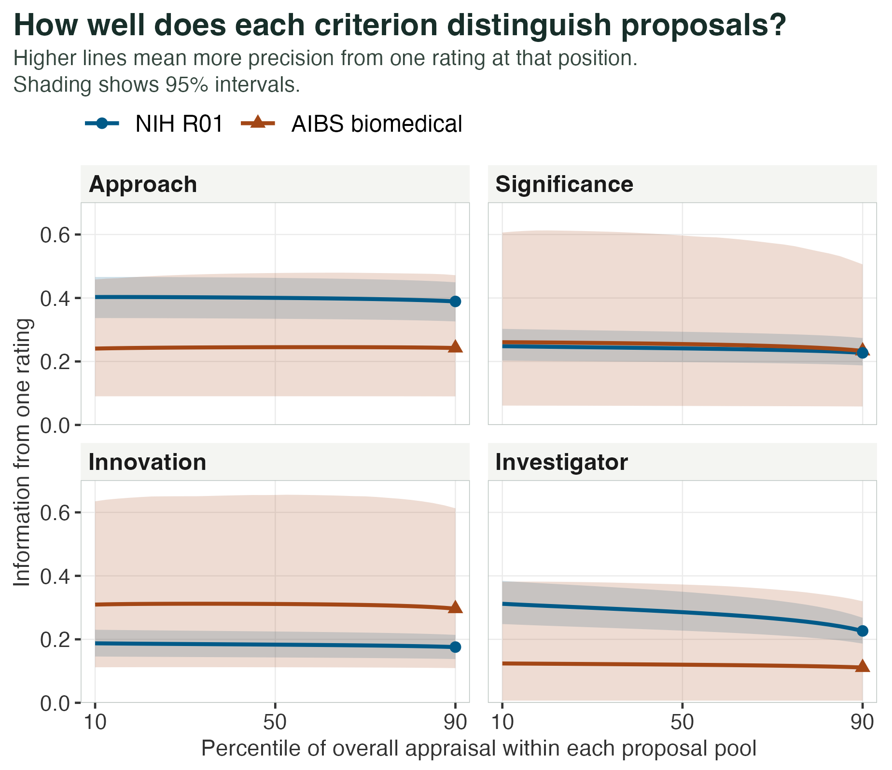
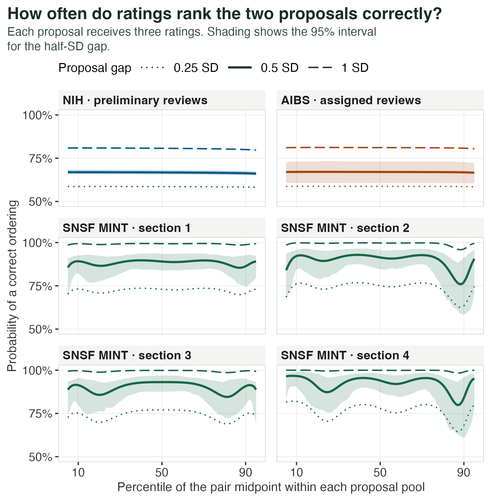

A funding panel has one invitation left. Two proposals sit either side of the line, separated by half a point. The panel can explain exactly how it averaged the scores. Can it explain how much evidence that half-point supplies for putting one proposal ahead of the other?

In one Horizon Europe pilot, the strongest submissions advance directly to the second stage. The next group can enter a draw for invitations when its scores span at most half a point. How well can reviewers resolve differences of that size where the decision falls? [European Commission, October 2026](https://ec.europa.eu/info/funding-tenders/opportunities/portal/screen/support/faq/107102).

I examined public reviews from three settings. Each contains several judgements of the same application. That repetition lets us estimate which differences persist across reviewers and how much room the scoring scale gives them to express those differences. The records capture assessments made at the time of review. They cannot tell us what an unfunded project would have achieved.

For a pair centred at the 80th percentile and separated by half a standard deviation in underlying appraisal, three ratings per proposal put the higher-appraised one first about two times in three in the US samples. In four Swiss project-funding sections, the corresponding estimates ranged from 85% to 91%.

| Review setting | Proposals | Ratings | Reviewers | What reviewers scored |
| --- | ---: | ---: | --- | --- |
| US National Institutes of Health (NIH) | 2,076 | 5,802 | 4,555 | Preliminary impact and criteria, 1–9 |
| American Institute of Biological Sciences (AIBS) review | 72 | 216 | 26 | Scientific merit and criteria, 1–5 in tenths |
| Swiss National Science Foundation (SNSF), MINT | 353 | 2,838 | 9 per section | Panel votes, six grades, four sections |
| SNSF Postdoc.Mobility, discussed applications | 79 | 1,623 | 14–29 per panel | Panel votes, six grades, five panels |

The NIH sample spans 200 scientific review groups and several years. AIBS assigned three reviewers to every proposal. The Swiss project-funding data cover all evaluated proposals in four sections with separate budgets. The fellowship votes cover only the 79 of 181 submissions that reached discussion. [NIH data dictionary](https://search.r-project.org/CRAN/refmans/ShinyItemAnalysis/html/NIH.html) · [AIBS data](https://doi.org/10.6084/m9.figshare.12728087) · [Swiss data](https://doi.org/10.5281/zenodo.4531160).

## What would three ratings resolve?

Imagine two applications that differ by half a standard deviation in how favourably reviewers of that competition tend to see them. Give each three ratings. How often would the higher-appraised one get the better mean score? For an exact tie, give each an equal chance. Now repeat that comparison at different places on the scale, keeping the distance between the two proposals fixed.

Item response theory (IRT) connects recorded grades to an unobserved quantity, here the appraisal that tends to recur across reviews of a proposal. I gave each proposal equal weight and modelled normally distributed underlying judgements that become grades at a series of thresholds. Grade frequencies locate the thresholds. Agreement between reviewers of the same application estimates how much of the judgement persists across assessors. For any given proposal, the calculation assumes independent ratings with constant residual spread along the scale. Changes in precision along a fitted curve therefore come from how reviewers use the grades. From the grade probabilities we can calculate the chances of every ordering of two three-rating averages.

A half-standard-deviation gap describes a difference relative to the variation among proposals in the same pool. The half point in the European rule is a distance on a particular scoring rubric. Connecting the two would require European ratings from the relevant call.

Erosheva and colleagues showed that estimated inter-rater reliability can approach zero when analysis is restricted to the best-scoring applications. Selecting a narrow group removes much of the variation between proposals from the calculation. Here the model learns from the available range of submissions and then asks about two applications at specified positions. [Erosheva, Martinková and Lee, 2021](https://doi.org/10.1111/rssa.12681).

## What the criteria contribute

Both US sources record significance, investigator, innovation and approach or feasibility. A criterion can contribute information about reviewers' overall appraisal if its ratings move with that appraisal and reviewers use its categories to express differences at the relevant part of the scale. The printed scale also overstates the variety of grades reviewers use. In AIBS, reviewers could enter a tenth of a point, yet 149 of the 216 overall scores were whole numbers.

The same person gives both criterion and overall scores. A reviewer who likes everything about an application can make the two look strongly related even when another reviewer sees it quite differently. I therefore related each criterion to the overall judgement of a *different* reviewer of the same application. The resulting information curves describe how much a rating on each criterion tells us about the overall appraisal that reviewers share. A funder may also value a feature on which its reviewers disagree.

*Figure 1. Each panel compares one criterion in NIH and AIBS. A higher curve means one rating on that criterion distinguishes small differences in underlying overall appraisal more precisely at that percentile of its own pool. Shading gives pointwise 95% intervals from resampling proposals.*

At the NIH 90th percentile, approach supplied more than twice the estimated information of innovation (0.39 versus 0.18). It also exceeded investigator and significance, each about 0.23. The differences between approach and each of the other three survived a joint uncertainty check across all six criterion comparisons. Reviewers' judgements about how the research would be done retained discriminatory power among highly rated applications. Whether that feature deserves the greatest policy weight is a separate judgement about what the programme aims to fund.

Innovation had the highest point estimate in AIBS. All six criterion differences had intervals that included zero. Omitting just one of the three review cycles could change which criterion came first. These data give little basis for choosing a preferred criterion in this programme.

## How stable is the ordering?

The horizontal axis in Figure 2 moves the midpoint between the two proposals through each pool. The solid line keeps their gap at half a standard deviation. Around the median the estimated chance of a correct ordering is about 67% in both US samples. At the 80th percentile it is 66.5% for NIH and 67.0% for AIBS. Allowing uncertainty from both sampled proposals and reviewers gives approximate 95% intervals of 65–68% and 61–73%, respectively.

*Figure 2. Chance that the higher-appraised proposal gets the better three-rating average, with a fair draw for ties. Dotted, solid and dashed lines show gaps of a quarter, half and one standard deviation within the pool. Shading gives pointwise 95% intervals for the half-SD curve from reweighting proposals and reviewers.*

In the US panels, moving the proposals further apart changes the result more than moving them towards the top. At the NIH 80th percentile, reducing the gap to a quarter of a standard deviation brings accuracy down to 58%. Increasing it to one standard deviation raises it to 80%. A proposal therefore has no single score above which every comparison involving it becomes unreliable. A close neighbour and a distant competitor present different decisions.

The Swiss project-funding results have a different shape. In section 3 the half-SD curve goes from about 85% at the 80th percentile to 91% at the 90th. A pair can straddle a grade boundary at one position, then land largely inside a single grade further up the scale. This produces dips and recoveries. The estimated correlation between two underlying ratings of the same proposal was about 0.35 in the US samples and 0.87–0.93 across the MINT sections. The Swiss votes came from members of the same panel. Shared information and a wider spread of appraisals can both increase that correlation. These records give us no independent repeat panel with which to separate the two. When we reserved three panel members' votes as a reference and compared them with separate votes, agreement was about 80% even for the smallest nonzero reference gap. That measures consistency within the panel. An independently convened panel might reach a different view.

A check on held-out proposals found that the AIBS model was optimistic near the top. For the most favourable quarter of predictions from two scores, it expected 19% of third reviews to award the best grade. Only 12% did.

Among Swiss fellowship applications selected for discussion, at the 80th percentile of each panel, half-SD ordering estimates were 64–67%, much closer to the US results. Both the stage of selection and the pool of proposals have changed. Calling the MINT result a Swiss advantage would hide that variation within the same funder.

## Choosing a rule for a lottery

The policy choice starts with the last available place. A funder can specify how much difference would matter between two projects competing for it, how much risk of reversing their order it will accept, and what it would cost to obtain more independent evidence. The direction of the question now changes. Given the actual ratings of two contenders at the budget line, how probable is it that their underlying appraisals are in the same order? Answering that requires the scores for those contenders and their uncertainty under the local review design.

Consider a funder willing to follow a score ranking if it orders a half-SD pair correctly at least 70% of the time. Both US point estimates are already below that target at the median and remain below it through the 95th percentile. Lower the target to 65% and both remain above it across that range. Neither rule locates a particular upper score where the system suddenly runs out of information.

In MINT section 3, extending the calculation towards the end of the scale put a downward crossing of 80% accuracy at the 96.7th percentile, an expected grade of 5.89 out of 6. Only 53% of proposal resamples produced a crossing followed by values below target through the end of the examined range. Requiring five expected applications beyond each end of the pair put that candidate outside the analysable range. In section 2 the stricter range gave a crossing near the 85th percentile, but the curve recovered above 80% when followed further. The apparent boundary depended on where we stopped looking.

Heyard and colleagues took a related approach at the SNSF. They estimated uncertainty in proposal ranks and identified applications whose rank intervals crossed a provisional funding line set by the budget. Our ordering calculation asks how well the scoring process can resolve a given gap. Their calculation locates individual decisions that remain uncertain around a budget line. [Heyard and colleagues, 2022](https://doi.org/10.1080/2330443X.2022.2086190).

For a pilot, I would ask independent reviewers to reassess a sample of close calls, retaining the individual criterion scores. Before looking at those new ratings, the funder could state the smallest distinction it wants to act on and its tolerance for reversing a decision. It could then check how often the ordering recurs, how many applications change sides at its actual budget line, and how many extra reviews would alter that number. Those quantities would give applicants a concrete explanation for the width of a lottery pool.

## Data and code

The accompanying reproducibility package includes scripts to retrieve the public records, reproduce the figures and examine other gaps and accuracy requirements. The expected-score calculation and figure design adapt code from the TGI-SR+ item response theory project. The package documents the source version and the changes for grant reviews.

The original article and figures are © 2026 Jorge Piano Simões and licensed under [CC BY 4.0](https://creativecommons.org/licenses/by/4.0/). Please cite this article and the original datasets you use.

## References

European Commission (2026). [How will the partial randomisation selection procedure work for this topic?](https://ec.europa.eu/info/funding-tenders/opportunities/portal/screen/support/faq/107102) Funding & Tenders Portal, FAQ 107102, 13 October.

Erosheva EA, Grant S, Chen MC, Lindner MD, Nakamura RK, Lee CJ (2020). [NIH peer review: Criterion scores completely account for racial disparities in overall impact scores](https://doi.org/10.1126/sciadv.aaz4868). *Science Advances*, 6, eaaz4868.

Erosheva EA, Martinková P, Lee CJ (2021). [When zero may not be zero: A cautionary note on the use of inter-rater reliability in evaluating grant peer review](https://doi.org/10.1111/rssa.12681). *Journal of the Royal Statistical Society: Series A*, 184, 904–919. [Reproducibility materials](https://doi.org/10.17605/OSF.IO/KNPH8).

Gallo S (2021). [Grant Peer Review Scoring Data with Criteria Scores](https://doi.org/10.6084/m9.figshare.12728087). Figshare dataset.

Heyard R (2021). [Individual panel votes for the SNSF funding-line case studies](https://doi.org/10.5281/zenodo.4531160). Zenodo dataset.

Heyard R, Ott M, Salanti G, Egger M (2022). [Rethinking the Funding Line at the Swiss National Science Foundation: Bayesian Ranking and Lottery](https://doi.org/10.1080/2330443X.2022.2086190). *Statistics and Public Policy*, 9, 110–121.
